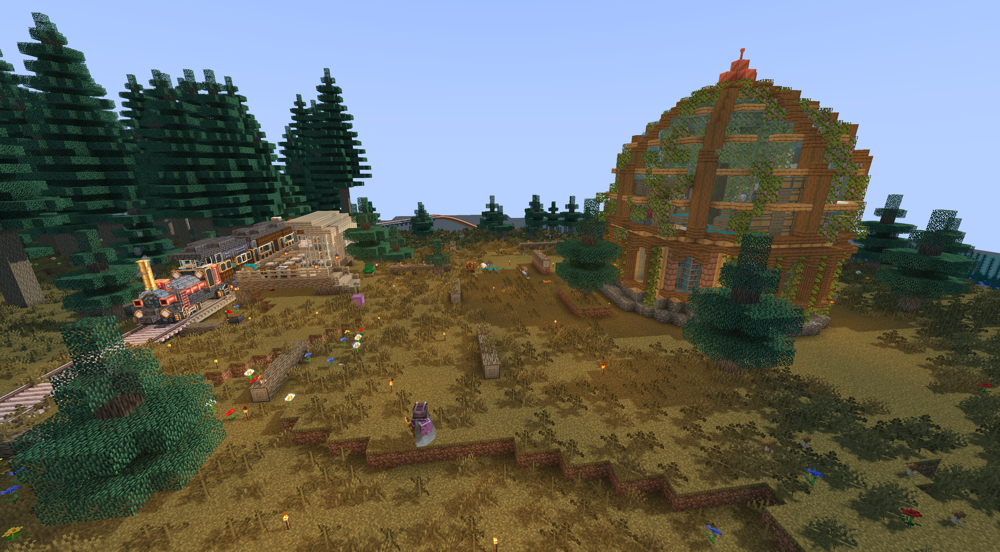
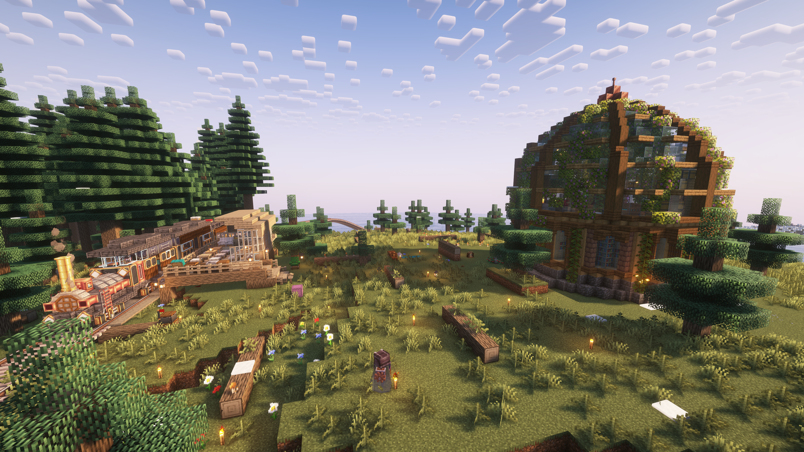

just a stupid shader for Minecraft and school-proj lab.

In response to requests from classmates, the repository has now been made publicly accessible.

this is purely for fun and learning purposes.

the shader is not intended to be used in real game play.

Me:

Complementary Reimagined _with custom fine-tuning_:

> should be version 5.5.1 (or 5.6rc), before the release of [5.6](https://modrinth.com/shader/complementary-reimagined/version/r5.6) which improved reflection handling and made every wooden tracks unreasonably _shining_ under daylight.
